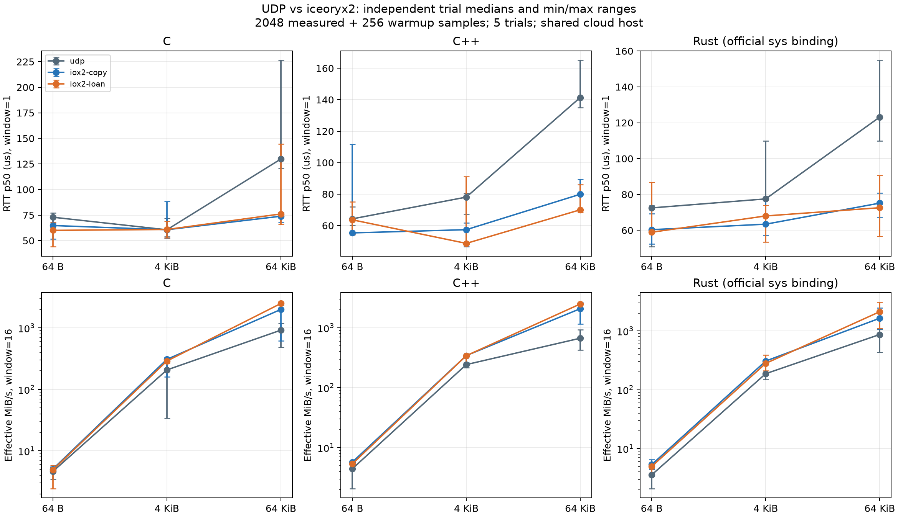

# iox2 共享内存：C / C++ / Rust 实测与问题分析

本报告基于 `0a68407`（v11.0.1-3 所指向的提交）及本次新增的测试代码。比较的是**同一 SDK、同一负载启用插件前后**，而不是两个不同版本的性能。新增测试源码的 SHA-256 随测量数据保存，不能把它们当成基线提交中已经存在的文件。

在本次 x86_64 云容器内，64 KiB 消息最明显受益：窗口 1 的 iox2-loan p50 RTT 相比 UDP 降低约 41.1%–50.5%；窗口 16 的有效应用速率约为 UDP 的 2.44–3.73 倍。64 B 和 4 KiB 的变化较小且有波动，loan 也不总比普通写入快。这些是共享宿主机上的观察结果，不是生产环境性能保证。

Rust 使用用户指定的官方 [cyclonedds-rust](https://github.com/eclipse-cyclonedds/cyclonedds-rust)。其高层 API 的 PSMX 回调当前未完成；可运行的 Rust 共享内存性能用例使用同一仓库的官方 sys 绑定。两者的结果严格分开报告。

## 1. 版本和环境

| 组件 | 固定版本 / 提交 |
|---|---|
| 父仓库基线 | `0a684079a83d81c2b7982834b1339e7e79c14342` |
| CycloneDDS | `6495609d7101992f1976fe9dab06ed790f287bda` |
| CycloneDDS-cxx | `33d27ffff4d76021d88653f778cc001aa1a2bb7a` |
| iceoryx2 | v0.10.0，`135d09dd8b29f321f1725920d434864c4e512378` |
| cyclonedds-rust | 0.0.4，`ef0dd5cc1477b29449aba1f717d9496db5953b2a` |

测量时间：2026-10-18T09:24:44Z（UTC，2026-10-18）。Linux x86_64，Intel Xeon Platinum 8573C，容器 CPU 配额 4 核、允许 CPU 集合 0–4、内存上限 32 GiB。未独占宿主机或为两个进程分别绑核。SDK 和基准使用 Release 构建；工具链为 cc (Debian 14.2.0-19) 14.2.0、c++ (Debian 14.2.0-19) 14.2.0、rustc 1.99.1 (58cf8f9c3 2026-10-13)、cmake version 4.4.4。

运行中保存了 cgroup CPU 计数，记录批次没有发生 cgroup quota throttling。该事实不能排除宿主调度、缓存竞争和其他进程造成的噪声，也不能代替进程级 CPU profile。本次没有测量功耗、跨机传输、多订阅者扩展性或 ARM 性能。

完整环境、源码与二进制指纹：[metadata.json](benchmark-results/2026-10-18/metadata.json)。测量 SDK 的 [CMake 参数](benchmark-results/2026-10-18/sdk-build-options.json) 也单独保存：DDS 和 C++ SDK 为 Release，另外启用了上游测试与示例；iceoryx2 仅构建 C FFI。这些参数在 UDP / iox2 各组之间完全一致。使用其他 SDK 配置时应重新采集对照数据。

## 2. 测试实现与控制变量

- **C**：`dds_create_*`、`dds_write`、`dds_take`；writer loan 由 `dds_request_loan` 获取，成功 write 转移所有权，reader loan 在检查后归还。
- **C++**：使用 CycloneDDS-cxx 的 typed `DataWriter` / `DataReader`，其扩展 `loan_sample()`，以及 RAII `LoanedSamples`。扩展 API 依赖已固定的绑定版本。
- **Rust**：使用官方 `eclipse-cyclonedds-sys`；直接在 Rust 中创建实体、设置 QoS、借用、收发、检查序号和归还 loan。C 库仅导出 `idlc` 生成的类型描述符。`ldd` 确认性能程序链接 `libbench_types.so` 和本项目 `libddsc.so`，不链接 C 测试端点 `libbench_ffi.so`。

IDL 为无 key、`@final` 的三种固定长度结构：8 B 序号加 56 / 4088 / 65528 B payload，总大小 64 / 4096 / 65536 B。Rust 通过官方 bindgen 类型和生成描述符校验尺寸，并使用 8 字节对齐的缓冲区。

三模式的差别：

| 模式 | 配置 | 发布端 | 接收端 |
|---|---|---|---|
| UDP（启用前） | 无 PSMX，固定 loopback | 普通 write | reader loan + 完整校验 |
| iox2-copy | 加载 `psmx_iox2` | 普通 write，仍需复制到插件存储 | reader loan + 完整校验 |
| iox2-loan | 同一插件 | 获取 writer loan，直接填写并发布 | reader loan + 完整校验 |

所有组使用 `RELIABLE`、`VOLATILE`、`KEEP_LAST(64)`，一致的 iox2 队列配置、编译优化、消息模式和预热流程。每次发送都会填写整个 payload，每次接收检查完整 `0xa5` pattern 和严格递增序号。窗口最大 16，测试驱动不并行执行进程对。

双方各自确认收发匹配后，通过驱动的双端屏障开始预热。每组预热 256 条，随后计时 2048 条；每种组合新建 5 对进程。先随机打散 270 组性能试验，再执行 18 组有向跨语言检查，共 288 组。随机 seed 固定为 `20261018`。

计量口径：

- p50 / p99 是每条请求到回复的完整 RTT；窗口 1 用于延迟比较，不估计 RTT/2 为单向延迟。
- 窗口 16 的 RTT 含排队；有效速率为 `N × 样本总字节 / 测量时长 / 2^20`。服务端还回送同等数据，因此不是单向无回送吞吐极限，也不是物理链路利用率。
- 每行数据是 5 次独立试验结果的中位数。误差棒为试验最小/最大值，非置信区间。保留慢试验和尾部延迟，未做离群值删除。
- 完成握手和实体销毁不计入 RTT / 速率计时；loopback 计数包含结束握手、发现及清理流量，属于辅助证据。

## 3. 实测结果



[SVG 原图](benchmark-results/2026-10-18/comparison.svg) · [所有 54 组同语言统计、范围与 p99](benchmark-results/2026-10-18/tables.md) · [逐次原始结果](benchmark-results/2026-10-18/raw.jsonl)

### 串行往返：窗口 1

| 语言 | 样本大小 | UDP p50 RTT μs | iox2-copy | iox2-loan |
|---|---:|---:|---:|---:|
| C | 64 B | 72.88 | 64.77 | 60.04 |
| C | 4 KiB | 60.59 | 60.65 | 60.88 |
| C | 64 KiB | 129.82 | 73.86 | 76.09 |
| C++ | 64 B | 64.24 | 55.33 | 63.66 |
| C++ | 4 KiB | 78.08 | 57.37 | 48.66 |
| C++ | 64 KiB | 141.42 | 79.90 | 70.02 |
| Rust sys | 64 B | 72.50 | 60.36 | 58.91 |
| Rust sys | 4 KiB | 77.52 | 63.41 | 68.01 |
| Rust sys | 64 KiB | 123.15 | 75.16 | 72.59 |

64 KiB 的收益比较稳定地反映在各组中位数上，但重复试验的范围仍有交叠。小消息不能据此宣称普遍提升：例如本次 C 的 4 KiB p50 RTT，UDP 为 60.59 μs，iox2-loan 为 60.88 μs，基本持平；C++ 的 64 B 同样没有明显 loan 优势。

### 窗口传输：64 KiB，窗口 16

| 语言 | UDP MiB/s | iox2-copy MiB/s | iox2-loan MiB/s | loan / UDP |
|---|---:|---:|---:|---:|
| C | 917.50 | 1992.30 | 2489.36 | 2.71× |
| C++ | 669.03 | 2080.73 | 2495.03 | 3.73× |
| Rust sys | 868.04 | 1640.80 | 2118.48 | 2.44× |

本次观察到约 2.44–3.73 倍 的有效速率提升。这里包含数据填写、校验、DDS API、队列和回送成本，无法单独分解序列化、内存复制或调度的贡献。小消息时，writer loan 的获取/释放、同步和接收唤醒等开销仍然明显。

### 验证共享内存路径

64 KiB、窗口 1、2048 条测量数据对应的 loopback TX 字节中位数如下：

| 语言 | UDP loopback TX B | iox2-loan TX B |
|---|---:|---:|
| C | 270945956 | 2696 |
| C++ | 270945900 | 2540 |
| Rust sys | 270945988 | 2728 |

UDP 的约 271 MB 与双向数据量及协议开销相符，iox2 仅有数 KB 的控制流量。再结合两端 `dds_is_shared_memory_available` 强制检查、真实 writer loan 调用和三语言互操作，支持该用例走共享内存而不是把 UDP 回退当作成功的结论。该计数不是逐包抓包或每次复制的 profile；共享内存模式仍使用网络进行发现。

同一语言内“配置前后”的差异更有解释价值；不同语言之间还混入 typed adapter、序列化实现、容器分配和计时 API 的差异，不能用这个表给语言本身排序。

## 4. 过程中的问题与修正

### 4.1 默认队列覆盖：DDS RELIABLE 不等于插件队列自动可靠

初始窗口 16 测试出现 `server sequence mismatch`。iceoryx2 v0.10.0 默认接收缓冲只有 2 个样本，且 `enable_safe_overflow=true`；队列满时可替换旧样本。当前 CycloneDDS 插件中，映射 DDS history 到 iox2 service 的代码仍是注释 / TODO。

采用项目级 [config/iceoryx2.toml](../config/iceoryx2.toml)，把接收队列设为 64 并关闭 safe overflow。保留 [初始错误](benchmark-results/2026-10-18/issues/default-overflow.log)。可靠性依靠端到端序号和 payload 校验验证，不以 DDS QoS 名称代替实测。

### 4.2 借用额度不足会造成长尾、停顿甚至超时

只增大接收队列仍不够。把借用上限设为 8 时，突发测试反复出现 `Failed to receive sample exceeds max borrows [1]`，并观察到秒级停顿；有些组合最终超时。保留 [诊断日志](benchmark-results/2026-10-18/issues/insufficient-borrows.log)。

原因是插件把接收的共享样本存入 DDS reader history 时仍持有 iox2 loan，不能只按应用一次 `take(1)` 来计算额度。最终设置为 128，覆盖 history 64、窗口 16 和交接余量；正式批次没有再出现插件错误。更大的额度也会增加内存预算，并非免费优化。生产中应重新按历史、发布者/订阅者数、窗口和消息长度评估。

### 4.3 双端发现屏障与结束握手

早期只要求本端发现完成就开始突发，出现过启动阶段收不到回复的超时。当前插件默认不接受未发现 writer 的样本；一端的匹配事件并不证明另一端已完成发现。

测试增加双方完成双向匹配后的管道屏障，以及最后回复的完成握手。经过 72 组 smoke 和两批各 288 组验证，本机复现未再出现。这是经过验证的协议修正；没有进行逐包/插件级追踪，不能把所有历史超时都唯一归因为发现竞态。退出握手同时避免示例中的短生命周期 writer 在最后一个样本被接收前销毁资源。

### 4.4 官方 Rust 高层 API 的实际限制

官方固定提交的 [`from_psmx` / `from_loaned_sample`](https://github.com/eclipse-cyclonedds/cyclonedds-rust/blob/ef0dd5cc1477b29449aba1f717d9496db5953b2a/cyclonedds/src/internal/ffi/serdata_ops.rs#L585-L620) 是打印诊断后返回空指针的 TODO。独立高层探测结果：

| 配置 | 结果 |
|---|---|
| 显式 UDP XML | 两个高层 API 进程完成收发 |
| 显式 iox2 XML | 命中 `serdata_ops::from_psmx<...>`，收发超时，退出码 1 |
| 官方 sys 绑定 + C IDL 描述符 | 三模式测试和跨语言检查成功 |

[高层探测结果](benchmark-results/2026-10-18/issues/rust-high-level-results.json) · [回调日志](benchmark-results/2026-10-18/issues/rust-high-level-psmx.log)

另外发现，`Domain::new()` 显式调用 `dds_create_domain(id, NULL)`，并不会像自动创建 participant 一样读取 `CYCLONEDDS_URI`。初始探测因此在设置 iox2 环境变量后仍能通过，却实际未加载对应 XML。修正为 `Domain::new_with_xml_config()` 后才暴露未实现回调。这个“成功”不能作为共享内存证据。

本实现保留官方高层探测，将其标记为**已知不支持**，不把它计入共享内存通过数量、不编造其性能；Rust 可运行路径采用该官方仓库的 sys 绑定，未修改上游源码，也未使用 `vendored` 另建未启用插件的内核。

### 4.5 构建、配置版本与验证边界

- Rust sys 的 bindgen 需要 libclang 和标准头文件。此容器起初只有 libclang 运行库，出现 `stdbool.h not found`；补齐受签名校验的 Clang 开发头文件并设置正确的 resource directory 后构建通过。
- 复用的 SDK 明确固定为 iceoryx2 v0.10.0。此前最新 main（0.10.999）已改变 WaitSet C API，当前 CycloneDDS 插件未兼容；不能将那组版本混入本次结果。
- 基线已有 CI 修复，避免 Rust setup action 把上游弃用警告升级为错误；这不改变运行时性能，也未关闭编译错误检查。
- README 旧的 `PSMX/Instances` XML 与固定 CycloneDDS 版本不匹配，已更新为 `General/Interfaces/PubSubMessageExchange`。
- `tools/build.sh` 现在支持已激活的 Cargo / 自定义 CARGO_HOME，FFI 构建使用 lockfile；C++ SDK 也明确使用 Release，避免把不同优化等级混入比较。

## 5. 验证结果、数据与复现

- 记录批次：270 组同语言性能试验 + 18 组互操作，**288 / 288 通过**；没有非空的插件诊断 stderr。
- 此前的复核批次同样为 288 / 288，另有 72 组最终配置 smoke 通过。复核批次原始数据保留在 [exploratory/](benchmark-results/2026-10-18/exploratory/)，不与本图混合汇总，也不删除其中慢试验。
- 3 组“要求 SHM 但加载 UDP”的负向检查通过，确认错误配置被拒绝。
- 完整执行修改后的 `tools/build.sh --build-cxx`，再用新生成的 `install/usr/local` SDK 在新构建目录重新编译并运行 72 组功能检查、3 组负向检查和高层 Rust 探测，结果符合上述分类。
- Rust 高层 API：UDP 通过；PSMX 为明确记录的已知不支持。它不是通过的性能样本。
- CI 已增加三语言构建、功能检查及诊断上传；本次仅本地执行过这些新增用例，没有声称更新后的远端 CI 已运行或通过。

复现入口：[benchmarks/README.md](../benchmarks/README.md)。主命令：

```bash
export CYCLONEDDS_HOME=/path/to/installed/cyclonedds-and-cxx
bash tools/build_benchmarks.sh
python3 benchmarks/run.py --samples 2048 --warmup 256 --repeats 5 --interop \
  --output benchmarks/results/new-run
```

绘图与数据整理使用 Matplotlib 3.11.2。所有统计可从 `raw.jsonl` 重建；文件完整性列表见 [SHA256SUMS](benchmark-results/2026-10-18/SHA256SUMS)。不同机器应重新采集数据，不沿用本机倍数作为验收阈值。
